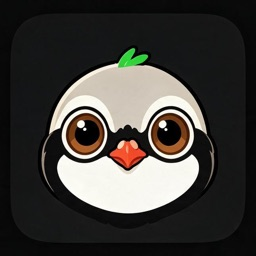
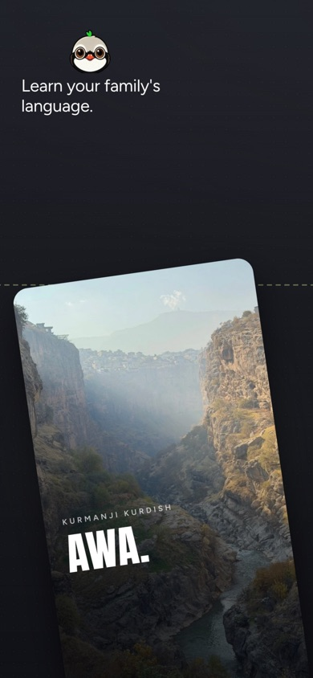
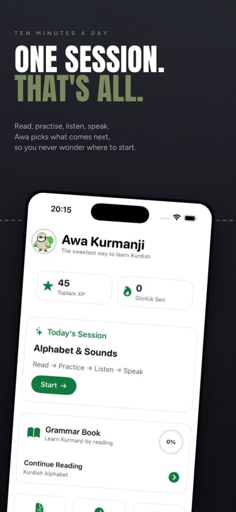
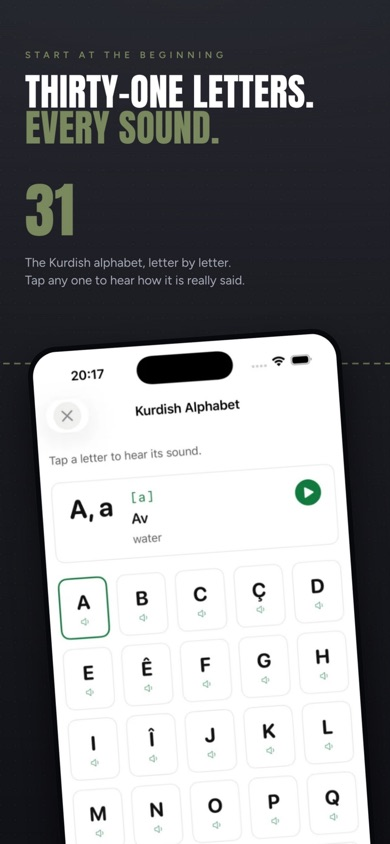
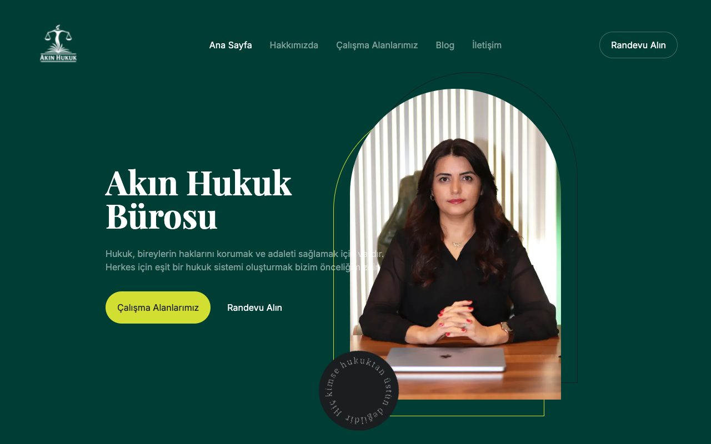
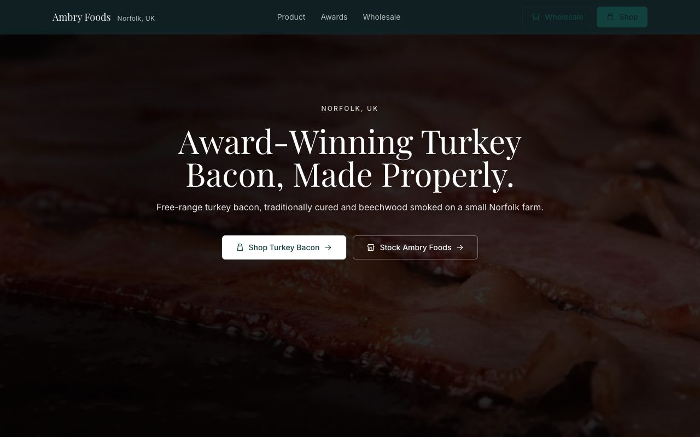
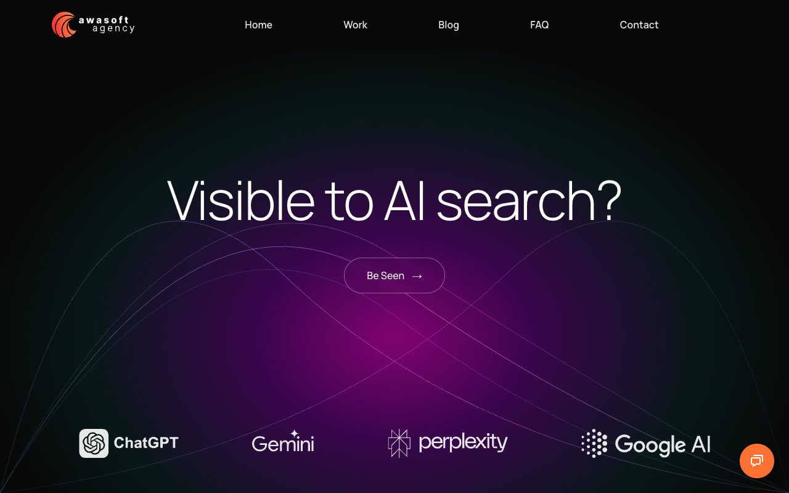
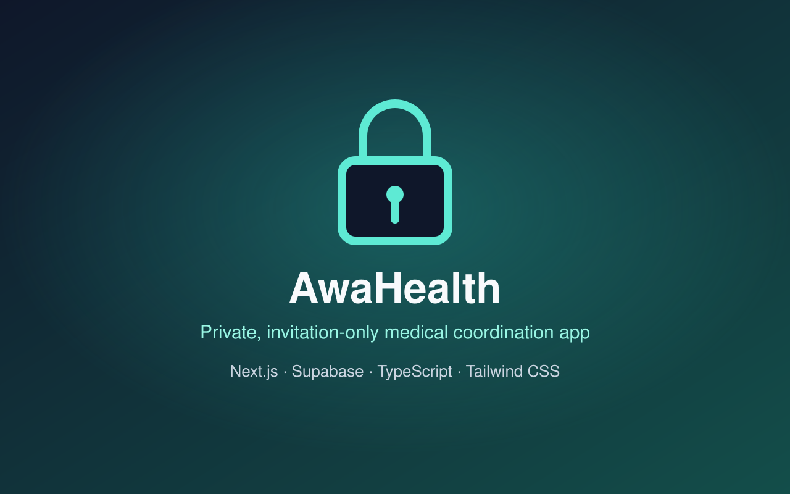
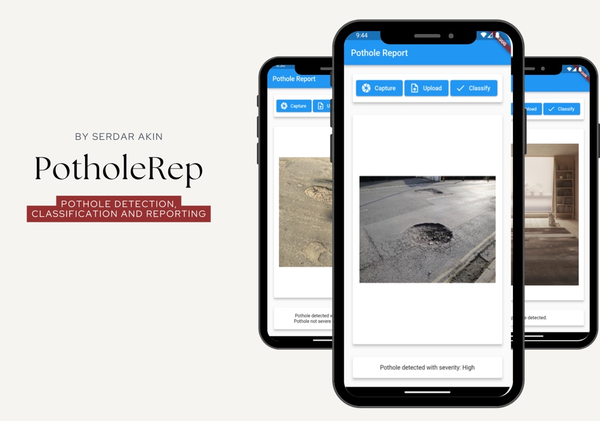

  
  
  
  

  
  
  

### Hey, I'm Serdar 👋

I'm a full stack developer who builds and ships products end to end. Most of my work lives somewhere between a backend API and the screen someone actually uses, and I like the problems where a real constraint forces a better design.

Currently building mobile and web products, and looking for a full stack or software developer role with a product team in Canada.

## 🚀 Featured Product

<table>
<tr>
<td width="56%" valign="top">

### Awa Kurmanji
**Language learning app for iOS and Android**

Native mobile app grown to **3,000+ registered users** organically with no marketing spend.

Redesigned a per-request text-to-speech integration into a generate-once, bundle-on-device pattern, which removed the ongoing API cost and made the feature work fully offline. Rebuilt onboarding around in-app analytics and doubled the average questions answered per user.

`Swift` `SwiftUI` `Kotlin` `Jetpack Compose` `Firebase`

</td>
<td width="44%" align="center" valign="middle">

</td>
</tr>
</table>

**Full stack cooperative portal.** Next.js, Express and PostgreSQL on a VPS for 200+ shareholders. Authentication, role-based access, document exports and ongoing maintenance.

## 🌐 Web Projects

<table>
<tr>
<td width="50%" valign="top">

#### [Akin Hukuk](https://avukatdilanakin.com)
Bilingual Turkish and English law firm site with an MDX blog, language switching and local SEO.

`Next.js` `Tailwind CSS` `Framer Motion` `Contentlayer`

  PageSpeed, mobile
</td>
<td width="50%" valign="top">

#### [Ambry Foods](https://ambry-foods.vercel.app)
Brochure site for an award-winning food brand, with product pages and a wholesale enquiry flow.

`Next.js` `React` `Vercel`

  PageSpeed, desktop
</td>
</tr>
<tr>
<td width="50%" valign="top">

#### [Awasoft Agency](https://www.awasoft.net)
My own agency site, built as a live proof of my frontend standards.

`Next.js` `Tailwind CSS` `Framer Motion` `Vercel`

  PageSpeed, mobile
</td>
<td width="50%" valign="top">

#### AwaHealth
Invitation-only medical coordination app for a family, with document uploads, AI-assisted categorisation, voice notes with transcription, a shared calendar and task assignments.

`Next.js` `Supabase` `TypeScript` `Tailwind CSS`

  PageSpeed, mobile
</td>
</tr>
</table>

The code for these is private because they are client or private builds, so the live sites are linked instead.

## 🔬 Engineering and Research

<table>
<tr>
<td width="50%" valign="top">

#### [PotholeRep](https://github.com/pserdarakin/PotholeRep)
MSc thesis project, awarded **Distinction**. Flutter Android app that detects potholes with an SSD MobileNetV2 model, classifies their severity with a custom CNN built in TensorFlow and Keras, and reports them to a Firebase database.

`Flutter` `TensorFlow` `Keras` `OpenCV` `Firebase`

 
</td>
<td width="50%" valign="top">

#### 🛩️ [Autonomous UAV Human Detection](https://github.com/pserdarakin/Autonomous-UAV-Face-Detection-for-Security)
BSc Mechanical Engineering thesis. I led a five-person team combining OpenCV detection in Python on a Raspberry Pi with MATLAB control systems and a SolidWorks airframe design.

`Python` `OpenCV` `Raspberry Pi` `MATLAB` `SolidWorks`

#### 🌬️ Drone for Wind Turbine Blade Inspection
BSc team project. A drone concept for spotting blade damage, using OpenCV and Python for image detection, a Raspberry Pi for controls and SolidWorks for the design.

`Python` `OpenCV` `Raspberry Pi` `SolidWorks`

#### 🌐 [My Portfolio Website](https://github.com/pserdarakin/my-portfolio)
Flask, HTML, CSS and JavaScript, with Flask-WTF for forms and Flask-Mail for the contact form.

`Flask` `Python` `HTML` `CSS` `JavaScript`
</td>
</tr>
</table>

## 🔧 Tech Stack

Also: Keras, Core ML, SwiftUI, Jetpack Compose, REST APIs, JWT auth, PM2

## 🧭 How I Work

I use AI tools daily, but the rule I hold myself to is *be a developer, not a vibe coder*: treat the model as a junior, keep full architectural understanding of what ships. I'd rather understand a system than generate one.

## 💡 A Few Things About Me

- 🎓 MSc Computer Science with Distinction, plus a BSc in Mechanical Engineering. The engineering background is where I learned to think in constraints.
- ♟️ Chess player, which is probably why I enjoy problems with a lot of branches.
- 🌍 Multilingual, and currently working on my German.
- 📚 Always learning. A lot of what I know came from building things that did not work the first time.

**📫 Get in touch:** [LinkedIn](https://www.linkedin.com/in/pserdarakin/) · [Awasoft Agency](https://www.awasoft.net) · [Projects on LinkedIn](https://www.linkedin.com/in/pserdarakin/details/projects/)

